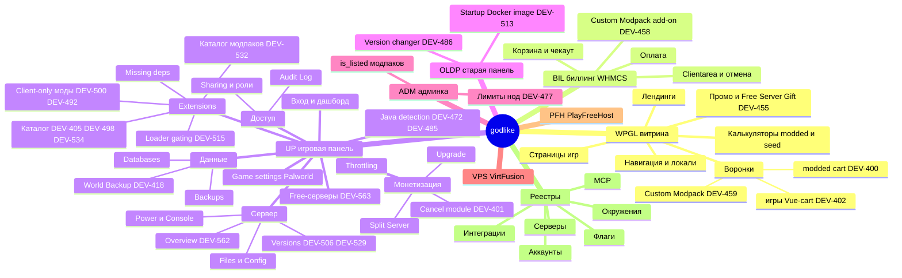

# Майндкарта проекта godlike

> **В двух словах.** Это карта всего, что делает godlike: витрина, биллинг, игровая панель, старая
> панель, админка, VPS и PlayFreeHost. Под каждым продуктом - его области и фичи, под фичами - тикеты.
> Картинка ниже для обзора (в Mermaid ссылки не кликаются), а под ней то же самое списком, где **каждый
> узел - ссылка**. Где своей страницы у узла ещё нет, ссылка ведёт на ближайшее описание (обзор продукта
> или инвентаризацию), такие узлы помечены ⚪.

Легенда: 📄 своя страница фичи · 🎫 только карточки тикетов · ⚪ страницы нет, ссылка на обзор.

## Картинка

## Карта ссылками

### [WPGL - витрина godlike.host](_meta/inventory-2026-10-15.md#2-карта-продукта-черновик-для-майндкарты) ⚪

- ⚪ [Навигация, 8 языков, валюты, CookieYes](_meta/inventory-2026-10-15.md#2-карта-продукта-черновик-для-майндкарты)
- ⚪ [Страницы игр, каталог игр, KB сайта, блог](_meta/inventory-2026-10-15.md#2-карта-продукта-черновик-для-майндкарты)
- 🎫 Калькуляторы modded и Seed finder - [DEV-532](tickets/DEV-532.md) (калькулятор modded-страницы)
- Воронки
  - 🎫 [DEV-400](tickets/DEV-400.md) - страницы модпаков → `cart-modded-new`
  - 🎫 [DEV-402](tickets/DEV-402.md) - страницы игр → Vue-cart
  - 🎫 [DEV-459](tickets/DEV-459.md) - Custom Modpack Setup, точки входа
- ⚪ [Лендинги: Launcher, SMP One-Click, Modpack Program, PlayFreeHost](_meta/inventory-2026-10-15.md#2-карта-продукта-черновик-для-майндкарты)
- 🎫 Промо и попапы - [DEV-455](tickets/DEV-455.md) (Free Server Gift)
- Инструменты WP: [MCP godlike-wp](registry/mcp-tools.md#серверы)

### [BIL - биллинг WHMCS](_meta/inventory-2026-10-15.md#2-карта-продукта-черновик-для-майндкарты) ⚪

- ⚪ [Корзина и чекаут, язык чекаута](_meta/inventory-2026-10-15.md#2-карта-продукта-черновик-для-майндкарты)
- ⚪ [Оплата: Stripe, PayPal, Crypto, кредит](registry/integrations.md)
- 🎫 Clientarea и отмена - [DEV-401](tickets/DEV-401.md) (Request Cancellation ведёт в cancel-модуль UP)
- 🎫 Custom Modpack Setup add-on - [DEV-458](tickets/DEV-458.md)
- 🎫 Free-продукты и письма - [DEV-455](tickets/DEV-455.md)
- 🎫 Тарифы для Upgrade - [TASK-tariff-list-400](tickets/TASK-tariff-list-400.md)

### [UP - игровая панель ultra.panel + API v2](products/up/README.md)

- ⚪ [Как устроено: Vue SPA, API v2, Pterodactyl, Pennant-флаги](products/up/README.md#как-устроено)
- 📄 [UP/login-dashboard](products/up/login-dashboard.md) - вход, дашборд My Servers, меню аккаунта
- Сервер
  - 📄 [UP/server-overview](products/up/server-overview.md) - Server Information, Edit Server: [DEV-562](tickets/DEV-562.md) (Steam Port)
  - 📄 [UP/power](products/up/power.md) - Start, Restart, Kill, EULA; гейт по Java см. [UP/java-detection](products/up/java-detection.md)
  - 📄 [UP/console](products/up/console.md) - лог и команды, палитра Commands
  - 📄 [UP/files](products/up/files.md) - файловый менеджер, Recycle Bin, SFTP
  - 📄 [UP/config](products/up/config.md) - server.properties и Docker/Java
  - 📄 [UP/players](products/up/players.md) - админы, whitelist, баны
  - 📄 [UP/versions](products/up/versions.md) - смена ядра и версии: [DEV-506](tickets/DEV-506.md), [DEV-529](tickets/DEV-529.md), [DEV-512](tickets/DEV-512.md)
  - 🎫 Startup / Docker image - [DEV-513](tickets/DEV-513.md) (проверялось в OLDP)
- Extensions
  - 📄 [UP/extensions-catalog](products/up/extensions-catalog.md) - каталог модов, плагинов, модпаков
    - 🎫 [DEV-405](tickets/DEV-405.md) - источник = прямые API CF/Modrinth, Update мода
    - 🎫 [DEV-498](tickets/DEV-498.md) - фильтр по загрузчику
    - 🎫 [DEV-534](tickets/DEV-534.md) - «All» = `any`
  - 📄 [UP/mods-loader-gating](products/up/mods-loader-gating.md) - каталог и установка по ядру
    - 🎫 [DEV-515](tickets/DEV-515.md) - автофильтр, заглушки, 409
    - 🎫 [DEV-529](tickets/DEV-529.md) - Arclight и Mohist после старта
    - Флаг: [flag:extension-compatibility](registry/flags.md#extension-compatibility)
  - 📄 [UP/client-only-mods](products/up/client-only-mods.md) - скрытие и отключение клиентских модов
    - 🎫 [DEV-500](tickets/DEV-500.md) - скрытие в каталоге
    - 🎫 [DEV-492](tickets/DEV-492.md) - скан после установки
  - 📄 [UP/modpack-catalog](products/up/modpack-catalog.md) - модпаки: видимость и установка
    - 🎫 [DEV-532](tickets/DEV-532.md) - `is_listed`, [flag:is-listed](registry/flags.md#is-listed)
    - 🎫 [DEV-459](tickets/DEV-459.md) - вход в Custom Modpack Setup
  - 📄 [UP/missing-mod-deps](products/up/missing-mod-deps.md) - [TASK-missing-mod-deps](tickets/TASK-missing-mod-deps.md)
- 📄 [UP/java-detection](products/up/java-detection.md) - требование к Java, попап, гейт старта
  - 🎫 [DEV-472](tickets/DEV-472.md) - автодетект и попап
  - 🎫 [DEV-485](tickets/DEV-485.md) - гейт старта, [flag:java-start-gate](registry/flags.md#java-start-gate)
  - 🎫 [DEV-512](tickets/DEV-512.md) - libxrender при смене версии
- Доступ
  - 📄 [UP/sharing-roles](products/up/sharing-roles.md) - инвайты, роли, Audit Log: [TASK-v2-subuser-permissions](tickets/TASK-v2-subuser-permissions.md)
- Данные
  - 📄 [UP/backups](products/up/backups.md) - бэкапы сервера, базы, папки
  - 📄 [UP/tasks](products/up/tasks.md) - задачи и расписание
  - 📄 [UP/databases](products/up/databases.md) - базы MySQL (stale, создание падало в июне)
  - 📄 [UP/ports-domains](products/up/ports-domains.md) - поддомен и порты
  - 📄 [UP/world-backup](products/up/world-backup.md) - [DEV-418](tickets/DEV-418.md), [flag:world-backup](registry/flags.md#world-backup)
- Монетизация
  - 📄 [UP/upgrade](products/up/upgrade.md) - Boost, тарифы, Free Premium: [TASK-tariff-list-400](tickets/TASK-tariff-list-400.md)
  - 📄 [UP/referral](products/up/referral.md) - реф-ссылка и вывод
  - 📄 [UP/throttling](products/up/throttling.md) - «Lag Detected»: [TASK-throttling-webhook](tickets/TASK-throttling-webhook.md)
  - 📄 [UP/cancel-module](products/up/cancel-module.md) - отмена, пауза, удержание: [DEV-401](tickets/DEV-401.md)
  - 📄 [UP/split-server](products/up/split-server.md) - [TASK-split-server](tickets/TASK-split-server.md)
- 📄 [UP/free-servers](products/up/free-servers.md) - ограничения free, запрет смены игры: [DEV-563](tickets/DEV-563.md)
- 📄 [UP/game-settings](products/up/game-settings.md) - Palworld Settings: [TASK-palworld-settings](tickets/TASK-palworld-settings.md)
- 📄 [UP/modals](products/up/modals.md) - каталог всплывающих окон и что с ними делать
- ⚪ [Сквозные гочи UP](products/up/README.md#сквозные-гочи) · [Пробелы в знаниях](products/up/README.md#пробелы)

### [OLDP - старая клиентская панель](_meta/inventory-2026-10-15.md#2-карта-продукта-черновик-для-майндкарты) ⚪

- 🎫 Version changer - [DEV-486](tickets/DEV-486.md), [DEV-512](tickets/DEV-512.md)
- 🎫 Startup / Docker image - [DEV-513](tickets/DEV-513.md)

### [ADM - админка panel.godlike.host/admin](_meta/inventory-2026-10-15.md#2-карта-продукта-черновик-для-майндкарты) ⚪

- 🎫 Лимиты ресурсов нод - [DEV-477](tickets/DEV-477.md)
- 🎫 Видимость модпаков `is_listed` - [DEV-532](tickets/DEV-532.md)
- 🎫 Docker image сервера - [DEV-513](tickets/DEV-513.md)

### [VPS - vf-panel (VirtFusion)](../agents.docs/vps-panel/KNOWLEDGE_BASE.md) ⚪

- ⚪ [Login, Overview, Power + Activity, Media, Network, Options, Rebuild](../agents.docs/vps-panel/KNOWLEDGE_BASE.md) - пока описано только в `agents.docs/vps-panel/`

### [PFH - PlayFreeHost](_meta/inventory-2026-10-15.md#2-карта-продукта-черновик-для-майндкарты) ⚪

- 🎫 Free-серверы, отдельный деплой фронта - [DEV-563](tickets/DEV-563.md)

### Реестры (общие для всех продуктов)

- [Окружения](registry/environments.md) - [env:prod](registry/environments.md#prod), [env:stage](registry/environments.md#stage)
- [Тест-аккаунты](registry/test-accounts.md) - [acc:shared-owner](registry/test-accounts.md#shared-owner), [acc:admin](registry/test-accounts.md#admin)
- [Тест-серверы](registry/test-servers.md) - канонический e2e [srv:ebb03adc](registry/test-servers.md#ebb03adc)
- [Фичефлаги](registry/flags.md)
- [Интеграции](registry/integrations.md) - CurseForge, Modrinth, Stripe, Amplitude, eSputnik и др.
- [MCP-серверы](registry/mcp-tools.md) - SQL к базам, инструменты WP
- [Все тикеты](tickets/README.md) · [Схема ID](_meta/id-scheme.md) · [Шаблоны](_meta/templates.md)

## Что дальше по карте

- UP описана целиком (28 страниц фич). Пост-инсталл скан модов намеренно живёт внутри [UP/client-only-mods](products/up/client-only-mods.md).
- Обзоры продуктов WPGL, BIL, OLDP, ADM, VPS, PFH (папки `kb/products/<prod>/` пока пустые): когда появятся,
  ⚪-ссылки на инвентаризацию заменить на них.
