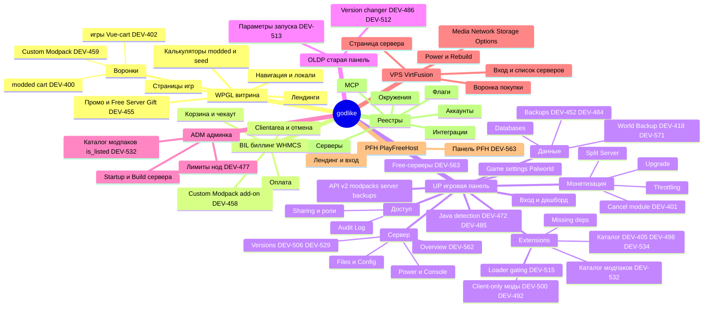

# Майндкарта проекта godlike

> **В двух словах.** Это карта всего, что делает godlike: витрина, биллинг, игровая панель, старая
> панель, админка, VPS и PlayFreeHost. Под каждым продуктом - его области и фичи, под фичами - тикеты.
> Картинка ниже для обзора (в Mermaid ссылки не кликаются), а под ней то же самое списком, где **каждый
> узел - ссылка**. Интерактивная версия (ветки сворачиваются, ссылки кликаются): [map.html](map.html),
> собирается `python -I kb/_tools/build_map.py .`. Где своей страницы у узла ещё нет, ссылка ведёт на ближайшее описание (обзор продукта
> или инвентаризацию), такие узлы помечены ⚪.

Легенда: 📄 своя страница фичи · 🎫 только карточки тикетов · ⚪ страницы нет, ссылка на обзор.

## Картинка

## Карта ссылками

### [WPGL - витрина godlike.host](products/wpgl/README.md)

- 📄 [Как устроено: WordPress, Polylang, кеш, аналитика, маршруты](products/wpgl/README.md#как-устроено)
- 📄 [Карта разделов: навигация, языки, игры, KB сайта, калькуляторы, лендинги](products/wpgl/README.md#карта-разделов)
- 📄 [Шапка, меню, 21 валюта (live 15-Oct)](products/wpgl/README.md#шапка-и-меню-live-15-oct) · [23 корзины](products/wpgl/README.md#корзины-funnel-страницы)
- 📄 [Шапка, футер, навигация, SEO](products/wpgl/header-navigation.md) · [языки и валюты](products/wpgl/locale-currency.md)
- 📄 [Каталог игр: сетка и «List of games»](products/wpgl/games-catalog.md) · [кастомайзер тарифа](products/wpgl/game-customizer.md)
- Воронки
  - 📄 [Воронка игрового сервера → WHMCS](products/wpgl/game-funnel.md) - 🎫 [DEV-402](tickets/DEV-402.md)
  - 📄 [Мобильная корзина](products/wpgl/mobile-cart.md)
  - 📄 [Modded-калькулятор](products/wpgl/modded-calculator.md) - 🎫 [DEV-532](tickets/DEV-532.md) · [modded-воронка](products/wpgl/modded-funnel.md) - 🎫 [DEV-400](tickets/DEV-400.md)
  - 📄 [Сиды: Seed finder, калькулятор, cart-seed](products/wpgl/seeds.md)
  - 📄 [Конструктор модпаков и trial](products/wpgl/modpack-constructor.md)
  - 📄 [Custom Modpack Setup](products/wpgl/custom-modpack-setup.md) - 🎫 [DEV-458](tickets/DEV-458.md), [DEV-459](tickets/DEV-459.md)
  - 📄 [VPS-воронка](products/vps/purchase-funnel.md)
- 📄 [Промо: MONTHLY75, MODPACK50, flash-sale, Free Server Gift](products/wpgl/promo.md) - 🎫 [DEV-455](tickets/DEV-455.md)
- 📄 [Лендинги без автотестов: Launcher, SMP, KB сайта, /servers/](products/wpgl/landings.md)
- 📄 [Гочи витрины](products/wpgl/README.md#гочи-для-тестирования)
- Инструменты WP: [MCP godlike-wp](registry/mcp-tools.md#серверы)

### [BIL - биллинг WHMCS](products/bil/README.md)

- 📄 [Как устроено: WHMCS, эндпоинты, связь с панелью](products/bil/README.md#как-устроено)
- 📄 [Чекаут и язык чекаута](products/bil/checkout.md) · [оплата: шлюзы, кредит, валюта](products/bil/payments.md) · [аккаунты: регистрация и вход](products/bil/accounts.md)
- 📄 [Услуги в кабинете, отмена и возврат](products/bil/services-cancellation.md) - 🎫 [DEV-401](tickets/DEV-401.md)
- 📄 [Free-продукты 282 / 1127 и письма eSputnik](products/bil/free-products.md) - 🎫 [DEV-455](tickets/DEV-455.md)
- 📄 [Add-on Custom Modpack Setup и trial конструктора](products/bil/addons-trials.md) - 🎫 [DEV-458](tickets/DEV-458.md)
- 📄 [Тарифы и апгрейд: tariffs-new, подарок Premium за цикл](products/bil/tariffs.md) - 🎫 [TASK-tariff-list-400](tickets/TASK-tariff-list-400.md), [DEV-595](tickets/DEV-595.md)

### [UP - игровая панель ultra.panel + API v2](products/up/README.md)

- ⚪ [Как устроено: Vue SPA, API v2, Pterodactyl, Pennant-флаги](products/up/README.md#как-устроено)
- 📄 [UP API v2](products/up/api/README.md) - swagger-подобная дока: [modpacks](products/up/api/modpacks.md), [server](products/up/api/server.md), [backups](products/up/api/backups.md)
- 📄 [UP/login-dashboard](products/up/login-dashboard.md) - вход, дашборд My Servers, меню аккаунта
- Сервер
  - 📄 [UP/server-overview](products/up/server-overview.md) - Server Information, Edit Server: [DEV-562](tickets/DEV-562.md) (Steam Port)
  - 📄 [UP/power](products/up/power.md) - Start, Restart, Kill, EULA; гейт по Java см. [UP/java-detection](products/up/java-detection.md)
  - 📄 [UP/console](products/up/console.md) - лог и команды, палитра Commands
  - 📄 [UP/files](products/up/files.md) - файловый менеджер, Recycle Bin, SFTP
  - 📄 [UP/config](products/up/config.md) - server.properties и Docker/Java
  - 📄 [UP/players](products/up/players.md) - админы, whitelist, баны
  - 📄 [UP/versions](products/up/versions.md) - смена ядра и версии: [DEV-506](tickets/DEV-506.md), [DEV-529](tickets/DEV-529.md), [DEV-512](tickets/DEV-512.md)
  - 🎫 Startup / Docker image - [DEV-513](tickets/DEV-513.md) (проверялось в OLDP)
- Extensions
  - 📄 [UP/extensions-catalog](products/up/extensions-catalog.md) - каталог модов, плагинов, модпаков
    - 🎫 [DEV-405](tickets/DEV-405.md) - источник = прямые API CF/Modrinth, Update мода
    - 🎫 [DEV-498](tickets/DEV-498.md) - фильтр по загрузчику
    - 🎫 [DEV-534](tickets/DEV-534.md) - «All» = `any`
  - 📄 [UP/mods-loader-gating](products/up/mods-loader-gating.md) - каталог и установка по ядру
    - 🎫 [DEV-515](tickets/DEV-515.md) - автофильтр, заглушки, 409
    - 🎫 [DEV-529](tickets/DEV-529.md) - Arclight и Mohist после старта
    - Флаг: [flag:extension-compatibility](registry/flags.md#extension-compatibility)
  - 📄 [UP/client-only-mods](products/up/client-only-mods.md) - скрытие и отключение клиентских модов
    - 🎫 [DEV-500](tickets/DEV-500.md) - скрытие в каталоге
    - 🎫 [DEV-492](tickets/DEV-492.md) - скан после установки
  - 📄 [UP/modpack-catalog](products/up/modpack-catalog.md) - модпаки: видимость и установка
    - 🎫 [DEV-532](tickets/DEV-532.md) - `is_listed`, [flag:is-listed](registry/flags.md#is-listed)
    - 🎫 [DEV-459](tickets/DEV-459.md) - вход в Custom Modpack Setup
    - 🎫 [DEV-452](tickets/DEV-452.md) - причины отказа пре-инсталл бэкапа
  - 📄 [UP/missing-mod-deps](products/up/missing-mod-deps.md) - [TASK-missing-mod-deps](tickets/TASK-missing-mod-deps.md)
- 📄 [UP/java-detection](products/up/java-detection.md) - требование к Java, попап, гейт старта
  - 🎫 [DEV-472](tickets/DEV-472.md) - автодетект и попап
  - 🎫 [DEV-485](tickets/DEV-485.md) - гейт старта, [flag:java-start-gate](registry/flags.md#java-start-gate)
  - 🎫 [DEV-512](tickets/DEV-512.md) - libxrender при смене версии
- Доступ
  - 📄 [UP/sharing-roles](products/up/sharing-roles.md) - инвайты, роли, Audit Log: [TASK-v2-subuser-permissions](tickets/TASK-v2-subuser-permissions.md)
- Данные
  - 📄 [UP/backups](products/up/backups.md) - бэкапы сервера, базы, папки
    - 🎫 [DEV-484](tickets/DEV-484.md) - пре-инсталл бэкап вне лимита
  - 📄 [UP/tasks](products/up/tasks.md) - задачи и расписание
  - 📄 [UP/databases](products/up/databases.md) - базы MySQL (stale, создание падало в июне)
  - 📄 [UP/ports-domains](products/up/ports-domains.md) - поддомен и порты
  - 📄 [UP/world-backup](products/up/world-backup.md) - [DEV-418](tickets/DEV-418.md), [DEV-571](tickets/DEV-571.md), [flag:world-backup](registry/flags.md#world-backup)
- Монетизация
  - 📄 [UP/upgrade](products/up/upgrade.md) - Boost, тарифы, Free Premium: [TASK-tariff-list-400](tickets/TASK-tariff-list-400.md)
  - 📄 [UP/referral](products/up/referral.md) - реф-ссылка и вывод
  - 📄 [UP/throttling](products/up/throttling.md) - «Lag Detected»: [TASK-throttling-webhook](tickets/TASK-throttling-webhook.md)
  - 📄 [UP/cancel-module](products/up/cancel-module.md) - отмена, пауза, удержание: [DEV-401](tickets/DEV-401.md)
  - 📄 [UP/split-server](products/up/split-server.md) - [TASK-split-server](tickets/TASK-split-server.md)
- 📄 [UP/free-servers](products/up/free-servers.md) - ограничения free, запрет смены игры: [DEV-563](tickets/DEV-563.md)
- 📄 [UP/game-settings](products/up/game-settings.md) - Palworld Settings: [TASK-palworld-settings](tickets/TASK-palworld-settings.md)
- 📄 [UP/modals](products/up/modals.md) - каталог всплывающих окон и что с ними делать
- ⚪ [Сквозные гочи UP](products/up/README.md#сквозные-гочи) · [Пробелы в знаниях](products/up/README.md#пробелы)

### [OLDP - старая клиентская панель](products/oldp/README.md)

- 📄 [Что известно о старой панели](products/oldp/README.md#что-известно)
- 📄 [Version Changer: смена версии и выбор Java, libxrender](products/oldp/version-changer.md)
- 📄 [Параметры запуска: образ Docker, «установлен администратором»](products/oldp/startup-params.md)
- 🎫 Version changer - [DEV-486](tickets/DEV-486.md), [DEV-512](tickets/DEV-512.md)
- 🎫 Startup / Docker image - [DEV-513](tickets/DEV-513.md)

### [ADM - админка panel.godlike.host/admin](products/adm/README.md)

- 📄 [Что известно об админке: разделы, ноды, флаги](products/adm/README.md#что-известно)
- 📄 [Сервер: Startup (образ, egg) и Build (Memory, лимит World Backup)](products/adm/server-startup.md)
- 📄 [Каталог модпаков v2: скрытие из клиентского каталога](products/adm/modpack-catalog.md)
- 📄 [Правило: ничего без ок владельца](products/adm/README.md#правила)
- 🎫 Лимиты ресурсов нод - [DEV-477](tickets/DEV-477.md)
- 🎫 Видимость модпаков `is_listed` - [DEV-532](tickets/DEV-532.md)
- 🎫 Docker image сервера - [DEV-513](tickets/DEV-513.md)

### [VPS - vf-panel (VirtFusion)](products/vps/README.md)

- 📄 [Как устроено, связь с биллингом](products/vps/README.md#как-устроено)
- 📄 [Карта разделов](products/vps/README.md#карта-разделов)
- 📄 [Вход, Dashboard и список серверов](products/vps/login-dashboard.md) · [страница сервера и вкладки](products/vps/server-page.md)
- 📄 [Power: Boot, Shutdown, Power Off, Restart](products/vps/power.md)
- 📄 [Rebuild: переустановка ОС](products/vps/rebuild.md)
- 📄 [Media: Boot Order](products/vps/media.md) · [Network](products/vps/network.md) · [Storage](products/vps/storage.md) · [Options: VNC, Rescue, пароль, Boot Type](products/vps/options.md)
- 📄 [Воронка покупки: лендинг → cart-vps → WHMCS](products/vps/purchase-funnel.md)
- 📄 [Гочи: DOM «врёт»](products/vps/README.md#гочи-для-тестирования)
- Сервер: [srv:9c49ed96](registry/test-servers.md#9c49ed96)

### [PFH - PlayFreeHost](products/pfh/README.md)

- 📄 [Из чего состоит](products/pfh/README.md#из-чего-состоит)
- 📄 [Лендинг: вход, регистрация, создание бесплатного сервера](products/pfh/landing.md) · [открытые находки (live 15-Oct)](products/pfh/landing.md#открытые-находки-recon-15-oct-2026)
- 📄 [Панель PFH: копия ultra.panel, отставание фронта](products/pfh/panel.md)
- 🎫 Панель PFH и запрет смены игры - [DEV-563](tickets/DEV-563.md)

### Реестры (общие для всех продуктов)

- [Окружения](registry/environments.md) - [env:prod](registry/environments.md#prod), [env:stage](registry/environments.md#stage)
- [Тест-аккаунты](registry/test-accounts.md) - [acc:shared-owner](registry/test-accounts.md#shared-owner), [acc:admin](registry/test-accounts.md#admin)
- [Тест-серверы](registry/test-servers.md) - канонический e2e [srv:ebb03adc](registry/test-servers.md#ebb03adc)
- [Фичефлаги](registry/flags.md)
- [Интеграции](registry/integrations.md) - CurseForge, Modrinth, Stripe, Amplitude, eSputnik и др.
- [MCP-серверы](registry/mcp-tools.md) - SQL к базам, инструменты WP
- [Внешние доки: Confluence DevOps и поддержки](registry/external-docs.md)
- [Глоссарий](glossary.md)
- [Все тикеты](tickets/README.md) · [Схема ID](_meta/id-scheme.md) · [Шаблоны](_meta/templates.md)

## Что дальше по карте

- Все 7 продуктов имеют обзор и страницы фич. Самые тонкие: [OLDP](products/oldp/README.md) (2 страницы), [ADM](products/adm/README.md) (2 страницы), [PFH](products/pfh/README.md) (2 страницы) - дополнять по мере задач.
- Отложено владельцем 15-Oct: витрина серверов `/servers/`, разбор 23 корзин витрины.
